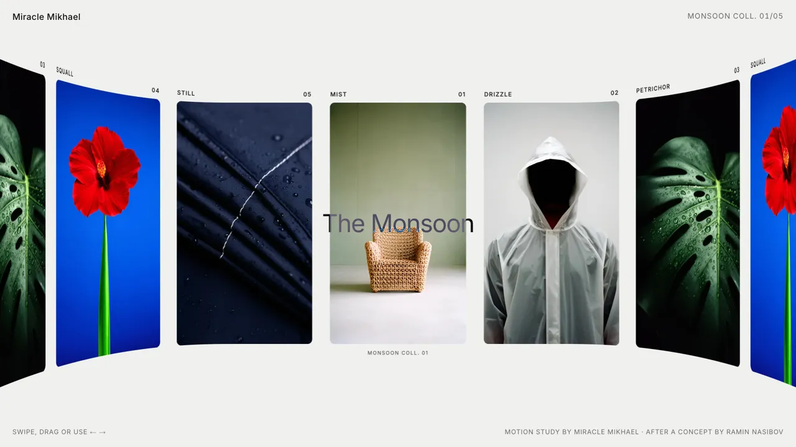

# Curved Ribbon Gallery

A horizontal card carousel bent like a concave wall. The centre stays flat, and the edges swell taller and squeeze in.

**Live demo:** https://monsoon.miraclemikhael.com



- Plain HTML + CSS + vanilla JS. No build step and no dependencies.
- A 2D canvas draws a flat strip of cards (image, label and number above, caption below). A single WebGL fragment shader then bends that strip on the way to the screen.
- The title is DOM text with `mix-blend-mode: difference`, so it flips black/white over each photo.
- Moves to the next card every 2s. You can also drag or swipe, use the wheel or trackpad, press ← →, or click a side card. Auto-advance pauses for 4s after you interact.
- Falls back to a flat 2D canvas when WebGL isn't available, and respects `prefers-reduced-motion` (no auto-advance).

## Run it

```bash
python3 -m http.server 8080 --directory public
# open http://localhost:8080
```

## Customise

All in `public/app.js`:

- `ITEMS`: card names and images (portrait, about 9:16).
- `WARP`: bend shape. `a` = flat zone (0–1 of half width), `k` = how much the edges grow, `p` = curve steepness, `kx` = horizontal squeeze.
- `PERIOD` / `STEP_DUR` / `IDLE_RESUME`: timing.
- `BG`: background colour (keep it in sync with `--bg` in `styles.css`).

### The warp

For each screen pixel, with `nx` = distance from centre as a share of half the width:

```
t  = clamp((nx - a) / (1 - a), 0, 1)
Sy = 1 + k * t^p                                  // vertical stretch
sx = |dx| + kx * hw * (1 - a) * t^(p+1) / (p+1)   // where to sample the flat strip
```

The same mapping is inverted in JS, so dragging follows your finger even at the curved edges.

## Recording mode

Open with `?record` to stop the animation loop, then step the clock yourself with `window.__advance(ms)`. Each frame renders exactly once, which is good for making frame-perfect videos with Puppeteer.

## Credits

- Motion study after a concept by [Ramin Nasibov](https://www.threads.com/@raminnasibov) ("The Undertow"). All code here is original.
- The photos in `public/img/` were generated for this project with FLUX.2 (Cloudflare Workers AI).

Code: MIT © Miracle Mikhael
